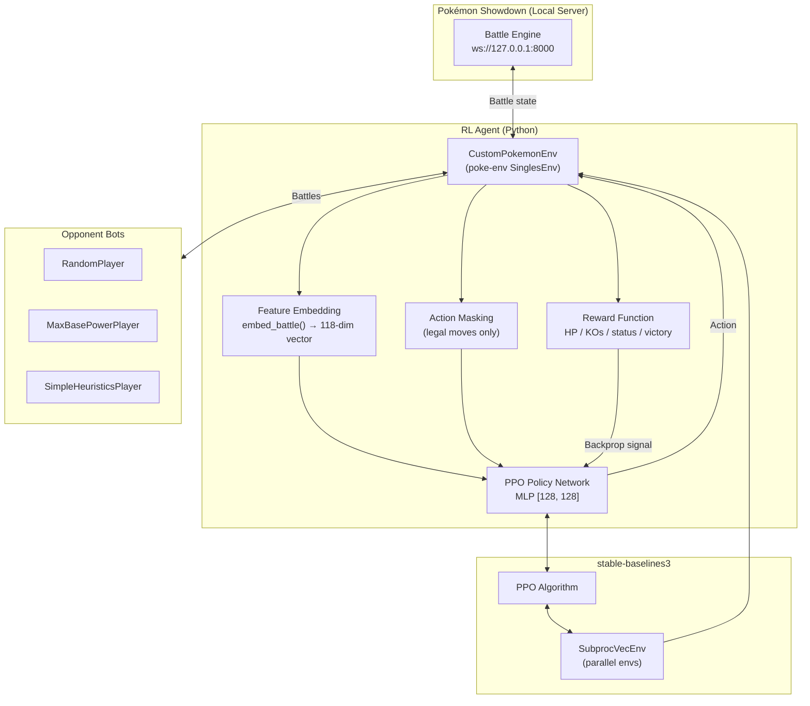
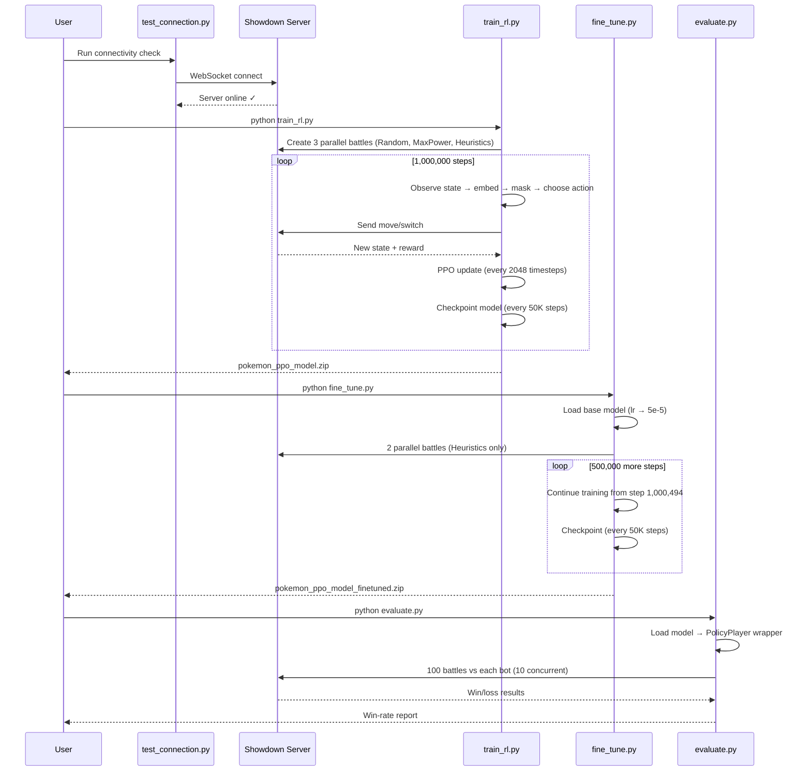
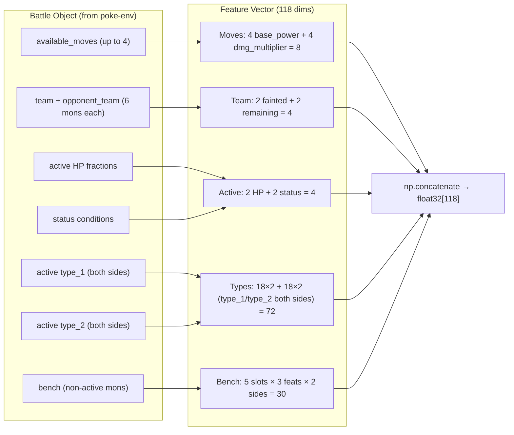
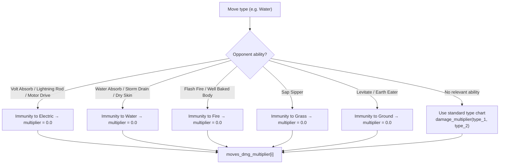
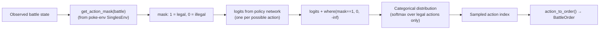
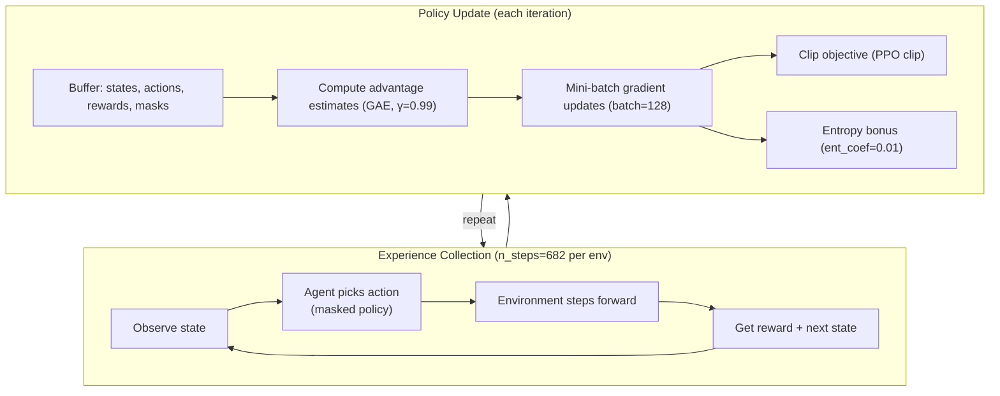
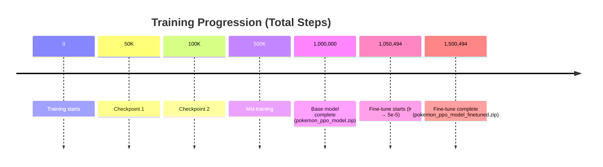

# Pokémon PPO Reinforcement Learning Agent — Complete Project Analysis

> A deep-dive analysis of a Proximal Policy Optimization (PPO) agent trained to play Pokémon Gen 8 Random Battles using `poke-env`, `stable-baselines3`, and PyTorch.

---

## Table of Contents

1. [Project Overview](#1-project-overview)
2. [Technology Stack](#2-technology-stack)
3. [Project Structure](#3-project-structure)
4. [High-Level Architecture](#4-high-level-architecture)
5. [Workflow](#5-workflow)
6. [Detailed Component Diagrams](#6-detailed-component-diagrams)
7. [Line-by-Line Code Explanation](#7-line-by-line-code-explanation)
   - [7.1 `pokemon_rl_common.py` — The Core Module](#71-pokemon_rl_commonpy--the-core-module)
   - [7.2 `train_rl.py` — Initial Training](#72-train_rlpy--initial-training)
   - [7.3 `fine_tune.py` — Specialization](#73-fine_tunepy--specialization)
   - [7.4 `evaluate.py` — Benchmarking](#74-evaluatepy--benchmarking)
   - [7.5 `test_connection.py` — Connectivity Check](#75-test_connectionpy--connectivity-check)
8. [Training History & Artifacts](#8-training-history--artifacts)
9. [Key Design Decisions](#9-key-design-decisions)
10. [Issues & Potential Improvements](#10-issues--potential-improvements)

---

## 1. Project Overview

This project trains a **reinforcement learning agent** to play Pokémon battles automatically. The agent learns by playing thousands of battles against scripted bot opponents through the **Pokémon Showdown** battle simulator (accessed via the `poke-env` Python library).

**Core Idea:** The agent observes a battle state (HP, types, moves, bench Pokémon, etc.), converts it into a numeric feature vector, and uses a neural network (PPO policy) to decide which action to take. Through trial and error, guided by a reward signal, it learns to win battles.

**Battle Format:** `gen8randombattle` — both players get random teams of 6 Pokémon from the Gen 8 (Sword/Shield) metagame.

**Training Recipe:**
1. **Pre-training** (~1M steps) against 3 different scripted bots simultaneously to build general skill.
2. **Fine-tuning** (~500K additional steps) against only the strongest bot (`SimpleHeuristicsPlayer`) to specialize.
3. **Evaluation** — benchmark win rates against all 3 bots.

---

## 2. Technology Stack

| Technology | Purpose |
|-----------|---------|
| **Python 3.10+** | Primary language (uses `X \| Y` type unions in `evaluate.py`) |
| **poke-env 0.10.0** | Python interface to the Pokémon Showdown simulator |
| **Pokémon Showdown (local server)** | Headless battle engine at `ws://127.0.0.1:8000` |
| **stable-baselines3** | PPO algorithm implementation, vectorized envs, callbacks |
| **PyTorch** | Neural network backend (MLP policy) |
| **Gymnasium** | `Box` observation space definition |
| **TensorBoard** | Training metrics logging (`tb_logs/`) |
| **NumPy** | Feature vector construction |
| **websockets** | Direct server connectivity test |

---

## 3. Project Structure

```
pokemon ppo/
├── pokemon_rl_common.py          # ⭐ Core: env, features, policy, helpers
├── train_rl.py                   # Initial PPO training script
├── fine_tune.py                  # Continued training / specialization
├── evaluate.py                   # Win-rate benchmarking vs bots
├── test_connection.py            # WebSocket connectivity sanity check
│
├── pokemon_ppo_model.zip         # Base model (~1M steps)
├── pokemon_ppo_model_finetuned.zip  # Fine-tuned model (~1.5M steps)
├── pokemon_ppo_model_backup 22.zip  # Dated backup copy
│
├── checkpoints/                  # 48 checkpoints, 50K → 1,000,000 steps
│   ├── pokemon_ppo_50000_steps.zip
│   ├── ...
│   └── pokemon_ppo_1000000_steps.zip
│
├── checkpoints_finetune/         # 10 checkpoints, 1,050,494 → 1,500,494
│   ├── pokemon_ppo_ft_1050494_steps.zip
│   └── ...
│
└── tb_logs/                      # TensorBoard run logs
    ├── ppo_pokemon_1/ … ppo_pokemon_18/   # 18 pre-training runs
    └── ppo_pokemon_finetune_0/            # 1 fine-tuning run
```

---

## 4. High-Level Architecture



### Component Responsibilities

| Component | Responsibility |
|-----------|---------------|
| **CustomPokemonEnv** | Wraps the battle engine; converts `Battle` objects → observations + rewards; enforces game rules |
| **embed_battle** | Hand-crafted feature extractor: turns a complex battle state into a 118-dimensional numeric vector the neural net can consume |
| **MaskedActorCriticPolicy** | PPO policy that **prevents illegal moves** by masking invalid action logits with `-inf` |
| **FeaturesExtractor** | Pass-through extractor — the raw embedding is already feature-engineered, so no CNN/MLP preprocessing needed |
| **PPO + SubprocVecEnv** | Trains the policy across multiple parallel battles (3 envs in training, 2 in fine-tuning) |
| **Opponent bots** | Provide diverse playstyles to prevent overfitting |

---

## 5. Workflow



### Detailed Workflow Steps

1. **Verify server** — `test_connection.py` confirms the local Pokémon Showdown server is reachable.
2. **Train** — `train_rl.py` launches 3 parallel environments, each against a different bot. The PPO agent collects experiences, updates its policy, and saves checkpoints every 50K steps. Final model: `pokemon_ppo_model.zip`.
3. **Fine-tune** — `fine_tune.py` loads the base model, halves the learning rate, and continues training for 500K steps **only vs SimpleHeuristicsPlayer** to specialize. Final model: `pokemon_ppo_model_finetuned.zip`.
4. **Evaluate** — `evaluate.py` loads the model and plays 100 battles against each of the 3 bots, reporting win percentages.
5. **Monitor** — TensorBoard logs in `tb_logs/` track reward, loss, entropy, and value loss curves.

---

## 6. Detailed Component Diagrams

### 6.1 Feature Embedding Pipeline (`embed_battle`)



**Feature vector layout (index ranges):**

| Indices | Content | Size |
|---------|---------|------|
| 0–3 | Move base powers (`base_power / 100`, `-1` if no move) | 4 |
| 4–7 | Move damage multipliers (ability-aware type chart) | 4 |
| 8–9 | Fainted fractions (team, opponent) | 2 |
| 10–11 | Remaining fractions (team, opponent) | 2 |
| 12–13 | Active HP fractions (ours, opponent) | 2 |
| 14–15 | Status flags (ours, opponent) | 2 |
| 16–33 | One-hot type_1 — our active | 18 |
| 34–51 | One-hot type_1 — opponent active | 18 |
| 52–69 | One-hot type_2 — our active | 18 |
| 70–87 | One-hot type_2 — opponent active | 18 |
| 88–102 | Our bench: 5 slots × (HP, fainted, matchup) | 15 |
| 103–117 | Opp bench: 5 slots × (HP, fainted, matchup) | 15 |

### 6.2 Ability-Aware Damage Multiplier Logic



### 6.3 Action Masking Flow



### 6.4 Training Loop (PPO)



---

## 7. Line-by-Line Code Explanation

---

## 7.1 `pokemon_rl_common.py` — The Core Module

This is the heart of the project. Every script imports from it. It defines the environment, the feature encoder, the reward function, and the custom PPO policy.

### Imports & Constants (Lines 1–25)

```python
"""
Shared code for the Pokemon PPO project (poke-env 0.10.0 compatible).
v2: adds type_2, bench-pokemon visibility (HP/fainted/matchup quality),
and a bigger [128, 128] network.
"""
```

**Lines 1–5:** The module docstring documents version 2 of the feature pipeline — it adds secondary type encoding (`type_2`), visibility into bench Pokémon (their HP, fainted status, and matchup quality vs the active Pokémon), and upgrades the policy network from `[64, 64]` to `[128, 128]`.

```python
import numpy as np
import torch
from gymnasium.spaces import Box
```

- **Line 6 (`import numpy as np`)**: NumPy is used to construct the feature vectors and perform array concatenation. Everything is done with `np.float32` for GPU-compatible efficiency.
- **Line 7 (`import torch`)**: PyTorch is needed for tensor operations inside the policy masking logic (`torch.where`).
- **Line 8 (`from gymnasium.spaces import Box`)**: Defines the observation space. `Box` represents a continuous n-dimensional space with lower/upper bounds — here a 118-dim vector with values in `[-1.0, 4.0]`.

```python
from poke_env.data import GenData
from poke_env.environment import SinglesEnv, SingleAgentWrapper
from poke_env.player import MaxBasePowerPlayer, RandomPlayer, SimpleHeuristicsPlayer
from stable_baselines3.common.monitor import Monitor
from stable_baselines3.common.policies import ActorCriticPolicy
from stable_baselines3.common.torch_layers import BaseFeaturesExtractor
```

- **Line 10 (`GenData`)**: Provides game data utilities — specifically `type_chart`, the Gen 8 type-effectiveness table used for damage multiplier calculations.
- **Line 11 (`SinglesEnv, SingleAgentWrapper`)**: `SinglesEnv` is poke-env's base class for single battles. `SingleAgentWrapper` is a convenience wrapper that converts a two-agent env (you + opponent) into a single-agent gym env — exactly what stable-baselines3 expects.
- **Line 12**: Three scripted opponent bots:
  - `RandomPlayer` — picks random legal moves.
  - `MaxBasePowerPlayer` — always uses the move with the highest base power.
  - `SimpleHeuristicsPlayer` — the strongest baseline; uses heuristics like type matchups, STAB (Same-Type Attack Bonus), status moves, and switching.
- **Line 13 (`Monitor`)**: A stable-baselines3 wrapper that logs rewards, episode lengths, and timestamps — crucial for TensorBoard tracking.
- **Line 14 (`ActorCriticPolicy`)**: The base class for SB3 policies with separate actor (policy) and critic (value) networks.
- **Line 15 (`BaseFeaturesExtractor`)**: SB3's abstract class for extracting features from raw observations before they go into the MLP.

```python
BATTLE_FORMAT = "gen8randombattle"
MAX_BENCH = 5  # team size 6 - 1 active = 5 possible bench slots
```

- **Line 17**: The battles are Gen 8 (Sword/Shield) **random battles** — both trainers receive a randomly generated team of 6 Pokémon. This is the standard format for RL research with poke-env because it avoids team-building complexity and tests in-battle decision-making.
- **Line 18**: Each team has 6 Pokémon. One is active; the remaining 5 sit on the bench. `MAX_BENCH = 5` fixes the bench-feature size so the observation vector has a constant dimension regardless of how many Pokémon have fainted.

```python
ALL_TYPES = [
    "normal", "fire", "water", "grass", "electric", "ice",
    "fighting", "poison", "ground", "flying", "psychic", "bug",
    "rock", "ghost", "dragon", "steel", "dark", "fairy"
]
TYPE_TO_IDX = {t: i for i, t in enumerate(ALL_TYPES)}
```

- **Lines 20–24**: The 18 Pokémon types in the Gen 8 metagame, in canonical order.
- **Line 25**: A lookup dict mapping each type name string to its index — e.g. `TYPE_TO_IDX["fire"] == 1`. Used by `encode_type` for fast one-hot conversion.

```python
# Feature breakdown:
# 4 move base powers + 4 move damage multipliers                  =  8
# + 2 fainted fractions + 2 remaining fractions                    =  4
# + 2 active HP fractions + 2 status flags                         =  4
# + 18 user active type_1 + 18 opp active type_1                   = 36
# + 18 user active type_2 + 18 opp active type_2                   = 36
# + 5 bench slots x 3 feats (hp, fainted, matchup) x 2 sides       = 30
N_FEATURES = 8 + 4 + 4 + 36 + 36 + (MAX_BENCH * 3 * 2)
```

- **Lines 27–34**: Documented breakdown of the 118-dimensional feature vector:
  - 8 = 4 move base powers + 4 move damage multipliers
  - 4 = fainted fractions + remaining fractions (both teams)
  - 4 = active HP fractions + status flags (both sides)
  - 36 = one-hot type_1 × 2 sides
  - 36 = one-hot type_2 × 2 sides
  - 30 = 5 bench slots × 3 features each × 2 sides
- **Line 34**: `N_FEATURES = 8 + 4 + 4 + 36 + 36 + 30 = 118`.

### Type Encoding Helper (Lines 37–44)

```python
def encode_type(type_enum) -> np.ndarray:
    """One-hot encodes a Pokemon type (or an all-zero vector if None/typeless)."""
    vec = np.zeros(len(ALL_TYPES), dtype=np.float32)
    if type_enum is not None:
        type_str = type_enum.name.lower()
        if type_str in TYPE_TO_IDX:
            vec[TYPE_TO_IDX[type_str]] = 1.0
    return vec
```

- **Line 38**: Docstring. `type_enum` is a `poke_env` `Type` enum (or `None` for typeless Pokémon or when no active Pokémon exists).
- **Line 39**: Creates an all-zero 18-dim float32 vector. If no type or an unknown type, the output is all zeros (model interprets: "unknown / no information").
- **Line 40**: Guard clause — `None` means no active Pokémon (e.g., forced switch), so return zeros.
- **Line 41**: Converts the enum to lowercase string, e.g. `Type.FIRE.name` → `"FIRE"` → `"fire"`.
- **Line 42**: Lookup check (avoids KeyError on typeless forms like the move "Curse" ghost-type edge cases).
- **Line 43**: Sets the corresponding index to 1.0 — one-hot encoding.
- **Line 44**: Returns the vector.

### Type Chart Accessor (Lines 47–48)

```python
def _type_chart(battle):
    return GenData.from_gen(battle.gen).type_chart
```

- **Line 47**: Helper to fetch the type-effectiveness chart for the current battle's generation. `battle.gen` gives the generation number (8), and `GenData.from_gen(8)` loads Gen 8 data.
- **Line 48**: Returns the `type_chart` dict, structured as `{attacking_type: {defending_type: multiplier}}`.

### Ability Immunity Map (Lines 51–70)

```python
# Abilities that grant full immunity to (and usually benefit from) a specific
# attacking type. The raw type chart has no concept of abilities, so without
# this, a move like Surf into a Water Absorb user looks identical to Surf
# into anything else - the model has no way to see the absorption coming.
# Not exhaustive (e.g. Wonder Guard's "only super-effective hits" rule and
# Dry Skin's extra Fire weakness aren't modeled), but covers the common
# single-type absorption/immunity abilities.
ABILITY_TYPE_IMMUNITIES = {
    "voltabsorb": "electric",
    "lightningrod": "electric",
    "motordrive": "electric",
    "waterabsorb": "water",
    "stormdrain": "water",
    "dryskin": "water",
    "flashfire": "fire",
    "wellbakedbody": "fire",
    "sapsipper": "grass",
    "levitate": "ground",
    "eartheater": "ground",
}
```

- **Lines 51–57**: Commentary explaining the motivation. The standard type chart only models type-vs-type interactions. It has no concept of abilities. Without this map, a Water move aimed at a `Water Absorb` Pokémon looks identical to one aimed at a normal Water-resistant Pokémon — the model would learn the wrong expectation. This map teaches the encoder that certain abilities completely nullify specific types.
- **Lines 58–70**: The map itself. Each key is a normalized ability name; each value is the type it grants immunity to:
  - Volt Absorb / Lightning Rod / Motor Drive → immune to Electric
  - Water Absorb / Storm Drain / Dry Skin → immune to Water
  - Flash Fire / Well Baked Body → immune to Fire
  - Sap Sipper → immune to Grass
  - Levitate / Earth Eater → immune to Ground

> **Note**: The docstring acknowledges this is not exhaustive — Wonder Guard, Dry Skin's Fire weakness, and Thick Fat's resistances aren't modeled. This is a pragmatic trade-off to keep the feature engineering manageable.

### Ability Name Normalization (Lines 73–77)

```python
def _normalize_ability(ability) -> str:
    if not ability:
        return ""
    return ability.lower().replace(" ", "").replace("-", "").replace("'", "")
```

- **Line 74**: Guard — if the Pokémon has no ability (or it's unknown), return an empty string.
- **Line 75**: Normalizes punctuation/casing. Example: `"Water Absorb"` → `"waterabsorb"`, `"Well-Baked Body"` → `"wellbakedbody"`, `"Lightning Rod"` → `"lightningrod"`. This ensures the map lookups match regardless of how poke-env formats the ability string.

### STAB / Damage Multiplier with Ability Awareness (Lines 79–92)

```python
def _stab_multiplier_vs(attacker_type, defender, battle) -> float:
    """Type-effectiveness multiplier of an attack of `attacker_type` against
    `defender`, zeroed out if defender's ability grants immunity to that
    exact type (Water Absorb, Levitate, Flash Fire, etc.)."""
    if attacker_type is None or defender is None:
        return 1.0

    immune_type = ABILITY_TYPE_IMMUNITIES.get(_normalize_ability(getattr(defender, "ability", None)))
    if immune_type is not None and attacker_type.name.lower() == immune_type:
        return 0.0

    return attacker_type.damage_multiplier(
        defender.type_1, defender.type_2, type_chart=_type_chart(battle)
    )
```

- **Line 80**: Docstring explaining the semantics — this computes "how effective would a move of `attacker_type` be against `defender`", with ability immunities zeroed out.
- **Lines 82–83**: If either side is missing (no active mon), assume neutral 1.0× multiplier.
- **Line 85**: Looks up the defender's ability (using `getattr` with a default of `None` for safety) in the immunity map.
- **Line 86**: If the defender has a relevant immunity ability **and** the attacker's type matches the immunity type, the multiplier is **0.0** — the move would do zero damage (and potentially heal the defender).
- **Lines 88–91**: Otherwise, use the standard type chart: `attacker_type.damage_multiplier(defender.type_1, defender.type_2)` — handles dual-type interactions (e.g. Fire against Grass/Bug = 4×).

### Bench Feature Extraction (Lines 95–122)

```python
def _bench_features(bench_mon, reference_mon, battle, mon_is_attacker: bool) -> list:
    """3 features for one bench slot: hp_fraction, fainted flag, matchup quality.

    mon_is_attacker=True  -> "how good would switching TO this mon be"
                              (its types attacking the opposing active)
    mon_is_attacker=False -> "how dangerous is this opposing bench mon"
                              (its types attacking our active)
    Missing/unknown slots return a neutral [0.0, 0.0, 1.0] (no info, no threat).
    """
```

- **Line 96**: Docstring — for each bench slot we produce 3 numbers:
  - `hp_fraction` — how healthy the bench mon is
  - `fainted` — whether it's knocked out
  - `matchup` — quality of the type matchup
  - For our bench (`mon_is_attacker=True`): how well this mon would fare if switched in against the opponent's active.
  - For opponent bench (`mon_is_attacker=False`): how dangerous this mon is if it comes in against our active.
  - Missing slots → `[0.0, 0.0, 1.0]` ("no info, no threat" — neutral matchup 1.0).

```python
    if bench_mon is None:
        return [0.0, 0.0, 1.0]
```

- **Lines 103–104**: If the bench slot is empty (fewer than 5 bench mons alive/revealed), return the neutral placeholder.

```python
    hp = bench_mon.current_hp_fraction if bench_mon.current_hp_fraction else 0.0
    fainted = 1.0 if bench_mon.fainted else 0.0
```

- **Line 106**: HP fraction — `current_hp_fraction` returns a float 0–1, or 0.0 if unknown (opponent's mons aren't fully visible).
- **Line 107**: Binary fainted flag → 1.0 or 0.0.

```python
    if reference_mon is None:
        matchup = 1.0
    else:
        attacker_types = bench_mon if mon_is_attacker else reference_mon
        defender = reference_mon if mon_is_attacker else bench_mon
```

- **Lines 109–113**: Determines the attacker/defender roles:
  - `mon_is_attacker=True` (our bench): `bench_mon` attacks `reference_mon` (opponent active).
  - `mon_is_attacker=False` (opp bench): `reference_mon` (our active) is attacked by `bench_mon` — so we check `bench_mon`'s types **against our active**. Actually wait — re-reading: `attacker_types = bench_mon` when `mon_is_attacker=True`, but when `False`, `attacker_types = reference_mon`. Hmm, this means:
    - For our bench: bench_mon's types attack the opponent active.
    - For opp bench: our active's types attack the bench mon (i.e., "how well could WE hit THIS mon if it came in"). So the matchup feature represents **our offensive coverage against that opp bench mon**.
  - If `reference_mon is None`, matchup stays neutral 1.0.

```python
        mult1 = _stab_multiplier_vs(attacker_types.type_1, defender, battle)
        if attacker_types.type_2 is not None:
            mult2 = _stab_multiplier_vs(attacker_types.type_2, defender, battle)
            matchup = max(mult1, mult2)
        else:
            matchup = mult1
```

- **Lines 114–119**: Computes the damage multiplier for the attacker's `type_1` against the defender, and if the attacker has a `type_2`, also for `type_2`.
- **Lines 118**: Takes `max()` — the best available offensive type matchup. Rationale: the mon can select its best attacking move, so the best multiplier is what matters most.
- **Line 121**: Returns the 3 features.

### Main Feature Embedding (Lines 125–191)

```python
def embed_battle(battle) -> np.ndarray:
    """Turns a Battle object into a flat feature vector (see N_FEATURES above)."""
    moves_base_power = -np.ones(4, dtype=np.float32)
    moves_dmg_multiplier = np.ones(4, dtype=np.float32)

    opp_active = battle.opponent_active_pokemon
    our_active = battle.active_pokemon
    opp_is_statused = opp_active.status is not None if opp_active else False
```

- **Line 127**: Docstring.
- **Line 128**: Initializes move base powers to `-1.0` — sentinel meaning "no move in this slot" (if the Pokémon has fewer than 4 moves, or is forced to switch).
- **Line 129**: Initializes damage multipliers to `1.0` (neutral) by default.
- **Lines 131–132**: Caches the active Pokémon objects for both sides.
- **Line 133**: `opp_is_statused` = True if the opponent active has a non-`None` status (burn, poison, paralysis, sleep, freeze).

```python
    for i, move in enumerate(battle.available_moves[:4]):
        moves_base_power[i] = move.base_power / 100.0
        if move.base_power == 0 and opp_is_statused:
            moves_dmg_multiplier[i] = 0.0
        elif opp_active is not None:
            moves_dmg_multiplier[i] = _stab_multiplier_vs(move.type, opp_active, battle)
```

- **Lines 134–138**: Loops over up to 4 available moves:
  - **Line 135**: Normalizes base power to 0–1.5 range (max base power in Gen 8 is 150 = 1.5 after division).
  - **Lines 136–137**: Special case — if the move has 0 base power (status move like Will-O-Wisp, Toxic) **and** the opponent is already statused, set the multiplier to 0.0. This signals the model "this status move is useless right now."
  - **Lines 138**: Otherwise compute the ability-aware type multiplier for the move against the opponent.
  - `battle.available_moves[:4]` — sloppy edge case if a Pokémon had more than 4 moves (normally impossible), but safe slicing.

```python
    team_size = max(len(battle.team), 1)
    opp_team_size = max(len(battle.opponent_team), 1)

    fainted_team = len([m for m in battle.team.values() if m.fainted]) / team_size
    fainted_opp = len([m for m in battle.opponent_team.values() if m.fainted]) / opp_team_size
    remaining_team = 1.0 - fainted_team
    remaining_opp = 1.0 - fainted_opp
```

- **Lines 141–142**: Team sizes with a floor of 1 — avoids division-by-zero and produces a harmless 0/1 = 0.0 if a team is empty (shouldn't happen mid-battle, but safe).
- **Lines 144–145**: Fraction of fainted Pokémon per team.
- **Lines 146–147**: Remaining fractions (complement of fainted). 

> ⚠️ **Observation**: `remaining_team` is exactly `1 - fainted_team`, so these are redundant features (deterministic duplicates). Harmless but wastes 2 dimensions.

```python
    our_hp = our_active.current_hp_fraction if our_active else 0.0
    opp_hp = opp_active.current_hp_fraction if opp_active else 0.0
    our_status = 1.0 if our_active and our_active.status else 0.0
    opp_status = 1.0 if opp_is_statused else 0.0
```

- **Lines 149–152**: Active HP fractions (float 0–1, or 0.0 if no active) and binary status flags.

```python
    our_type1_vec = encode_type(our_active.type_1 if our_active else None)
    opp_type1_vec = encode_type(opp_active.type_1 if opp_active else None)
    our_type2_vec = encode_type(our_active.type_2 if our_active else None)
    opp_type2_vec = encode_type(opp_active.type_2 if opp_active else None)
```

- **Lines 154–157**: One-hot encodings of both active Pokémon's primary and secondary types. `None` → all-zero vector (typeless or no active).

```python
    our_bench = [m for m in battle.team.values() if not m.active][:MAX_BENCH]
    opp_bench = [m for m in battle.opponent_team.values() if not m.active][:MAX_BENCH]
```

- **Lines 160–162**: Builds bench lists — all team members that are **not** the active Pokémon, truncated to 5 slots. (For the opponent, unrevealed mons may not be in `opponent_team` yet, so the bench may be shorter — those missing slots get the neutral placeholder.)

```python
    our_bench_feats = []
    for i in range(MAX_BENCH):
        mon = our_bench[i] if i < len(our_bench) else None
        our_bench_feats.extend(_bench_features(mon, opp_active, battle, mon_is_attacker=True))

    opp_bench_feats = []
    for i in range(MAX_BENCH):
        mon = opp_bench[i] if i < len(opp_bench) else None
        opp_bench_feats.extend(_bench_features(mon, our_active, battle, mon_is_attacker=False))
```

- **Lines 164–169**: For each of the 5 bench slots (or the neutral placeholder if empty), extract 3 features for our bench. `mon_is_attacker=True` → "how good would switching TO this mon be against the opponent's active."
- **Lines 171–173**: Same for the opponent bench, `mon_is_attacker=False` → "how dangerous is this bench mon against our active."

```python
    return np.concatenate(
        [
            moves_base_power,
            moves_dmg_multiplier,
            [fainted_team, fainted_opp],
            [remaining_team, remaining_opp],
            [our_hp, opp_hp],
            [our_status, opp_status],
            our_type1_vec,
            opp_type1_vec,
            our_type2_vec,
            opp_type2_vec,
            our_bench_feats,
            opp_bench_feats,
        ],
        dtype=np.float32,
    )
```

- **Lines 175–191**: Concatenates all sub-vectors in order into a single flat `float32` array. This is exactly the layout documented by `N_FEATURES` (8 + 4 + 4 + 36 + 36 + 30 = 118).

### The Environment Class (Lines 194–210)

```python
class CustomPokemonEnv(SinglesEnv):
    def __init__(self, **kwargs):
        super().__init__(**kwargs)
        box_space = Box(low=-1.0, high=4.0, shape=(N_FEATURES,), dtype=np.float32)
        self.observation_spaces = {agent: box_space for agent in self.possible_agents}
```

- **Line 195**: `CustomPokemonEnv` extends poke-env's `SinglesEnv`.
- **Line 196**: Passes all kwargs (battle format, log level, timeouts) to the parent constructor.
- **Line 197**: Defines the observation space — a 118-dim continuous box. Bounds `[-1, 4]` cover all possible feature values: sentinel `-1` (no move), HP fractions `[0,1]`, status `[0,1]`, type multipliers can reach `4.0` (quadruple super-effective vs dual-weak Pokémon).

  > The bound `4.0` is important — a Fire move vs a Grass/Bug Pokémon is 4× effective, so the high bound must accommodate the maximum type-chart multiplier.

- **Line 198**: Assigns the same observation space to all agents in the env (poke-env's multi-agent environment structure). Even though this is effectively single-agent (via `SingleAgentWrapper`), poke-env's API requires per-agent spaces.

```python
    def embed_battle(self, battle) -> np.ndarray:
        return embed_battle(battle)
```

- **Lines 200–201**: Overrides poke-env's abstract `embed_battle` hook with our feature encoder. poke-env calls this internally every time it needs an observation.

```python
    def calc_reward(self, battle) -> float:
        return self.reward_computing_helper(
            battle,
            fainted_value=2.0,
            hp_value=1.0,
            status_value=0.5,
            victory_value=30.0,
        )
```

- **Lines 203–210**: Overrides the reward function. `reward_computing_helper` (built into poke-env) computes a dense reward at each turn based on deltas:
  - **`fainted_value=2.0`**: +2 reward for each opponent fainted, −2 for each own fainted.
  - **`hp_value=1.0`**: +1 × (HP fraction gained) — rewards dealing damage, punishes taking damage.
  - **`status_value=0.5`**: ±0.5 for inflicting/receiving status conditions.
  - **`victory_value=30.0`**: +30 at battle win (large sparse bonus that dominates the reward at the end).
  - The actual delta computation: `delta = (new_value − old_value)` each turn, so the agent gets immediate feedback.

### Environment Factory (Lines 213–221)

```python
def create_env(opponent_cls=RandomPlayer):
    """opponent_cls lets different parallel envs train against different
    bots at once (see train_rl.py), so the policy doesn't overfit to any
    single opponent's quirks."""
    raw_env = CustomPokemonEnv(
        battle_format=BATTLE_FORMAT, log_level=40, open_timeout=None, strict=False
    )
    opponent = opponent_cls(start_listening=False)
    return Monitor(SingleAgentWrapper(raw_env, opponent))
```

- **Line 214**: Factory function with a default opponent of `RandomPlayer`.
- **Lines 215–216**: Docstring explaining the opponent-mixing strategy.
- **Lines 217–219**: Creates the raw env:
  - `battle_format=BATTLE_FORMAT` → gen8randombattle
  - `log_level=40` → only CRITICAL/ERROR-level logs (40 = logging.ERROR) — keeps training output clean
  - `open_timeout=None` → never time out waiting for the server
  - `strict=False` → tolerate some gameplay inconsistencies without crashing
- **Line 220**: Creates the opponent bot with `start_listening=False` — the opponent won't launch its own websocket connection; the env manages it.
- **Line 221**: Wraps in `Monitor` (reward/len logging) and `SingleAgentWrapper` (converts to a single-agent Gym environment for stable-baselines3).

### Feature Extractor & Masked Policy (Lines 224–252)

```python
class FeaturesExtractor(BaseFeaturesExtractor):
    def __init__(self, observation_space):
        super().__init__(observation_space, features_dim=N_FEATURES)

    def forward(self, obs):
        return obs["observation"]
```

- **Line 225**: `FeaturesExtractor` extends SB3's `BaseFeaturesExtractor`.
- **Line 226**: Declares the output dimension is already 118 (same as input) — the extractor is a **pass-through**.
- **Lines 228–229**: `forward` returns the `"observation"` key directly from the dict observation. Rationale: the hand-crafted `embed_battle` already does all feature engineering, so no learned feature extraction (CNN/etc.) is needed.

```python
class MaskedActorCriticPolicy(ActorCriticPolicy):
    def __init__(self, *args, **kwargs):
        super().__init__(
            *args,
            **kwargs,
            net_arch=[128, 128],  # bumped up from [64, 64]
            features_extractor_class=FeaturesExtractor,
        )
```

- **Line 233**: `MaskedActorCriticPolicy` extends SB3's `ActorCriticPolicy`.
- **Lines 234–238**: Constructor passes through all args but overrides:
  - `net_arch=[128, 128]` → two hidden layers of 128 neurons each (up from [64, 64]).
  - `features_extractor_class=FeaturesExtractor` → uses our pass-through extractor.
  - Total actor network: 118 → 128 → 128 → action_dim.
  - Total critic network: 118 → 128 → 128 → 1 (value).

```python
    def forward(self, obs, deterministic=False):
        self._mask = obs["action_mask"]
        return super().forward(obs, deterministic)

    def evaluate_actions(self, obs, actions):
        self._mask = obs["action_mask"]
        return super().evaluate_actions(obs, actions)
```

- **Lines 241–243**: Before running the standard forward pass, extract `action_mask` from the observation dict and store it on `self`. The mask is a binary vector where 1 = legal action, 0 = illegal.
- **Lines 245–247**: Same for `evaluate_actions` (used during training to compute log-probs of taken actions).
- `deterministic=False` → sample stochastically (exploration); `True` → take argmax.

```python
    def _get_action_dist_from_latent(self, latent_pi):
        action_logits = self.action_net(latent_pi)
        mask = torch.where(self._mask == 1, 0, float("-inf"))
        return self.action_dist.proba_distribution(action_logits + mask)
```

- **Line 250**: This is the key masking hook. SB3's `ActorCriticPolicy._get_action_dist_from_latent` builds the action probability distribution from the network's latent representation.
- **Line 251**: `self.action_net(latent_pi)` → raw logits (one per possible action).
- **Line 252**: `torch.where(self._mask == 1, 0, float("-inf"))` → creates a mask vector where legal actions add `0` (unchanged) and illegal actions add `-inf`.
- **Line 253**: Adds the mask to logits, then builds the categorical distribution. After softmax, `-inf` becomes exactly 0 probability — **illegal actions can never be sampled**.

> This is the standard "invalid action masking" technique. Without it, the agent would waste exploration on illegal moves (e.g., using a move that ran out of PP, or switching to a fainted Pokémon).

---

## 7.2 `train_rl.py` — Initial Training

This script runs the pre-training phase against three different bots.

```python
import asyncio
from functools import partial

from stable_baselines3 import PPO
from stable_baselines3.common.vec_env import SubprocVecEnv
from stable_baselines3.common.callbacks import CheckpointCallback
from poke_env.player import RandomPlayer, MaxBasePowerPlayer, SimpleHeuristicsPlayer

from pokemon_rl_common import create_env, MaskedActorCriticPolicy
```

- **Line 1 (`import asyncio`)**: Imported but **not used** in the script — a leftover (poke-env is async internally, but `model.learn` handles it). Harmless dead import.
- **Line 2 (`from functools import partial`)**: `partial(create_env, opponent_cls=opp)` pre-binds the `opponent_cls` argument, creating a no-arg callable — required by `SubprocVecEnv`, which calls each function to create an env in a subprocess.
- **Line 4 (`from stable_baselines3 import PPO`)**: The PPO algorithm class (Proximal Policy Optimization).
- **Line 5 (`SubprocVecEnv`)**: Creates parallel environments in separate subprocesses — enables CPU parallelism for collecting experiences.
- **Line 6 (`CheckpointCallback`)**: Periodically saves the model.
- **Line 7**: The three opponent classes.
- **Line 9**: Imports from the shared module.

```python
TOTAL_TIMESTEPS = 20000
MODEL_NAME = "pokemon_ppo_model"
TENSORBOARD_LOG_DIR = "./tb_logs"

# One opponent type per parallel env, so every policy update is trained
# against a mix rather than overfitting to one bot's pattern.
OPPONENTS = [RandomPlayer, MaxBasePowerPlayer, SimpleHeuristicsPlayer]
NUM_ENVS = len(OPPONENTS)
```

- **Line 11 (`TOTAL_TIMESTEPS = 20000`)**: Total steps for this run. ⚠️ **Config drift note**: the artifacts show 1M+ steps were actually run — this constant was likely reduced later for quick test runs. The file as it stands would only train 20K steps.
- **Line 12**: Output model filename → `pokemon_ppo_model.zip`.
- **Line 13**: TensorBoard log directory.
- **Line 17**: One opponent type **per** environment — 3 envs total.
- **Line 18**: `NUM_ENVS = 3`.

```python
def train():
    env_fns = [partial(create_env, opponent_cls=opp) for opp in OPPONENTS]
    env = SubprocVecEnv(env_fns)

    print(f"Initializing RL Agent (opponent mix: {[o.__name__ for o in OPPONENTS]})...")
    model = PPO(
        MaskedActorCriticPolicy,
        env,
        learning_rate=1e-4,
        n_steps=2048 // NUM_ENVS,
        batch_size=128,
        gamma=0.99,
        ent_coef=0.01,
        verbose=1,
        tensorboard_log=TENSORBOARD_LOG_DIR,
    )
```

- **Line 22**: `env_fns` — list of 3 thunk functions, one per opponent.
- **Line 23**: `SubprocVecEnv` launches 3 subprocesses, each running a battle env. This parallelizes data collection.
- **Line 25**: Logs which opponents are being used.
- **Lines 26–36**: PPO construction:
  - **Line 27**: The custom masked policy.
  - **Line 28**: The parallel environment.
  - **Line 29 (`learning_rate=1e-4`)**: 0.0001 — conservative learning rate for stable policy updates.
  - **Line 30 (`n_steps=2048 // NUM_ENVS`)**: 2048/3 = 682 steps per env per rollout. Total = 3×682 ≈ 2048 timesteps per policy update.
  - **Line 31 (`batch_size=128`)**: Mini-batch size for gradient descent.
  - **Line 32 (`gamma=0.99`)**: Discount factor — rewards 100 steps in the future are worth ~0.37× today.
  - **Line 33 (`ent_coef=0.01`)**: Entropy bonus coefficient — encourages exploration; prevents premature convergence to a single move.
  - **Line 34 (`verbose=1`)**: Print training info to console.
  - **Line 35**: TensorBoard logging destination.

```python
    checkpoint_callback = CheckpointCallback(
        save_freq=max(50_000 // NUM_ENVS, 1),
        save_path="./checkpoints/",
        name_prefix="pokemon_ppo",
    )
```

- **Lines 38–42**: Checkpoint every `50_000 // 3` env steps = 16,666 steps per env = **50,000 total timesteps**. Saves to `./checkpoints/pokemon_ppo_<steps>_steps.zip`. The `max(..., 1)` guard prevents division producing 0 (which would crash).

```python
    print(f"Starting training loop over {TOTAL_TIMESTEPS:,} steps...")
    model.learn(
        total_timesteps=TOTAL_TIMESTEPS,
        tb_log_name="ppo_pokemon",
        callback=checkpoint_callback,
    )

    print("\nTraining complete! Saving model to disk...")
    model.save(MODEL_NAME)
    env.close()

    print(f"\nDone. To view training curves, run:\n  tensorboard --logdir {TENSORBOARD_LOG_DIR}")
```

- **Line 45**: Kicks off the PPO training loop.
- **Line 46**: Total timesteps (20K as configured).
- **Line 47 (`tb_log_name="ppo_pokemon"`)**: Creates `tb_logs/ppo_pokemon_N/` — each run gets an incremented N (1, 2, 3, … 18 observed).
- **Line 48**: Checkpoint callback.
- **Line 51**: Saves the final model.
- **Line 52**: Closes the subprocesses.
- **Line 55**: Helper message telling the user how to launch TensorBoard.

```python
if __name__ == "__main__":
    train()
```

- **Lines 58–59**: Entry point guard — only runs `train()` when executed directly (not when imported).

---

## 7.3 `fine_tune.py` — Specialization

This script continues training the base model against only the strongest bot.

```python
from stable_baselines3 import PPO
from stable_baselines3.common.vec_env import SubprocVecEnv
from stable_baselines3.common.callbacks import CheckpointCallback
from poke_env.player import SimpleHeuristicsPlayer

from pokemon_rl_common import create_env, MaskedActorCriticPolicy
from functools import partial

FINE_TUNE_TIMESTEPS = 500_000
NUM_ENVS = 2
```

- **Lines 1–6**: Same imports as `train_rl.py`, but only `SimpleHeuristicsPlayer` is needed.
- **Line 7**: `partial` for env factories.
- **Line 9 (`FINE_TUNE_TIMESTEPS = 500_000`)**: 500K additional steps.
- **Line 10 (`NUM_ENVS = 2`)**: Only 2 parallel environments (both vs SimpleHeuristics).

```python
def fine_tune():
    env = SubprocVecEnv([partial(create_env, opponent_cls=SimpleHeuristicsPlayer) for _ in range(NUM_ENVS)])

    # Load your existing best model (the random-only 1M run) and swap in the new env
    model = PPO.load("pokemon_ppo_model", env=env, custom_objects={"learning_rate": 5e-5})
```

- **Line 13**: Creates 2 subprocess envs, both vs `SimpleHeuristicsPlayer`.
- **Line 16**: Loads the pre-trained base model (`pokemon_ppo_model.zip`):
  - `env=env` — attaches the new environment (the old env is gone).
  - `custom_objects={"learning_rate": 5e-5}` — **overrides the saved learning rate with 5e-5** (half of the original 1e-4). This is the standard fine-tuning recipe: smaller steps to avoid destroying the learned policy.

```python
    checkpoint_callback = CheckpointCallback(
        save_freq=max(50_000 // NUM_ENVS, 1),
        save_path="./checkpoints_finetune/",
        name_prefix="pokemon_ppo_ft",
    )
```

- **Lines 18–22**: Checkpoint every `50_000 // 2` = 25,000 env steps = 50K total steps. Saved to `./checkpoints_finetune/pokemon_ppo_ft_<steps>_steps.zip`.

```python
    model.learn(total_timesteps=FINE_TUNE_TIMESTEPS, tb_log_name="ppo_pokemon_finetune", callback=checkpoint_callback, reset_num_timesteps=False)
    model.save("pokemon_ppo_model_finetuned")
    env.close()

if __name__ == "__main__":
    fine_tune()
```

- **Line 24**: Trains 500K more steps:
  - `reset_num_timesteps=False` — **critical**: continues the global step counter from 1,000,494 instead of resetting to 0. This is why fine-tune checkpoints start at `1050494` (1,000,494 + 50,000), not at `50000`.
  - `tb_log_name="ppo_pokemon_finetune"` → new TensorBoard run folder.
- **Line 25**: Saves the final model as `pokemon_ppo_model_finetuned.zip`.
- **Line 26**: Closes subprocesses.
- **Lines 28–29**: Entry-point guard.

> **Note on Step Numbers**: The first fine-tune checkpoint is `1050494` — confirming the base model had exactly 1,000,494 steps (the +494 trailing steps come from the n_steps/batch_size mechanics of PPO rollouts).

---

## 7.4 `evaluate.py` — Benchmarking

This script plays battles against all 3 bots with a loaded model and reports win rates.

```python
import asyncio
import torch
import numpy as np
from typing import Any, Awaitable

from stable_baselines3 import PPO

from poke_env.environment import SinglesEnv
from poke_env.player import (
    BattleOrder,
    DefaultBattleOrder,
    MaxBasePowerPlayer,
    Player,
    RandomPlayer,
    SimpleHeuristicsPlayer,
)

from pokemon_rl_common import BATTLE_FORMAT, embed_battle

MODEL_NAME = "pokemon_ppo_model"
N_BATTLES = 100
```

- **Line 1 (`asyncio`)**: Required — the battle loop is asynchronous (`asyncio.run(main())`).
- **Line 2 (`torch`)**: For running the policy under `no_grad` and converting to tensors.
- **Line 3 (`numpy`)**: To convert the action mask to a numpy array.
- **Line 4 (`Any, Awaitable`)**: Type hints for the `choose_move` override.
- **Line 6 (`PPO`)**: To load the trained model.
- **Line 8 (`SinglesEnv`)**: Provides `get_action_mask` and `action_to_order` static methods.
- **Lines 9–15**: `BattleOrder` (the action type), `DefaultBattleOrder` (pass/do nothing when the battle is in a wait state), `Player` (base class), and the 3 opponent bots.
- **Line 18**: Imports the battle format constant and the feature embedder.
- **Line 20 (`MODEL_NAME = "pokemon_ppo_model"`)**: Which model to evaluate. ⚠️ To evaluate the fine-tuned model, change to `"pokemon_ppo_model_finetuned"`.
- **Line 21 (`N_BATTLES = 100`)**: 100 battles per opponent.

```python
class PolicyPlayer(Player):
    def __init__(self, policy, *args: Any, **kwargs: Any):
        super().__init__(*args, **kwargs)
        self.policy = policy
```

- **Line 24**: `PolicyPlayer` extends poke-env's `Player` class.
- **Line 25**: Stores the SB3 policy object (accessed via `ppo.policy`).
- **Line 26**: Passes battle_format, max_concurrent_battles etc. to the parent.
- **Line 27**: Saves the policy reference.

```python
    def choose_move(self, battle) -> BattleOrder | Awaitable[BattleOrder]:
        if battle.wait:
            return DefaultBattleOrder()

        obs = embed_battle(battle)
        mask = np.array(SinglesEnv.get_action_mask(battle))
```

- **Line 29**: The method poke-env calls every turn. Returns a `BattleOrder` (or an awaitable — this is straightforward so it returns directly).
- **Lines 30–31**: If the battle is in a "wait" state (e.g., the server is processing), return a default order (skip).
- **Line 33**: Embeds the battle into the 118-dim feature vector using the **same** function used in training — **critical** for consistent observations.
- **Line 34**: Gets the legal-action mask from poke-env (`1` = legal move/switch, `0` = illegal).

```python
        with torch.no_grad():
            obs_dict = {
                "observation": torch.as_tensor(obs, device=self.policy.device).unsqueeze(0),
                "action_mask": torch.as_tensor(mask, device=self.policy.device).unsqueeze(0),
            }
            action, _, _ = self.policy.forward(obs_dict)
```

- **Line 36 (`with torch.no_grad():`)**: Disables gradient tracking — inference only, saves memory and speeds up forward pass.
- **Lines 37–39**: Builds the observation dict matching training format:
  - `"observation"` → the feature vector as a tensor on the policy's device, with `unsqueeze(0)` adding a batch dimension (`[1, 118]`).
  - `"action_mask"` → the mask tensor, batch dimension added (`[1, num_actions]`).
- **Line 40**: `self.policy.forward(obs_dict)` runs the masked policy (which clips illegal actions). Returns `(action, value, log_prob)` — we only need the action.

```python
        return SinglesEnv.action_to_order(action.cpu().numpy()[0], battle)
```

- **Line 43**: `action.cpu().numpy()[0]` — moves the action tensor to CPU, converts to numpy, and takes the batch element → a scalar action index. `action_to_order` converts the index back to a `BattleOrder` (specific move/switch) that the environment understands.

```python
async def main():
    print(f"Loading model '{MODEL_NAME}'...")
    ppo = PPO.load(MODEL_NAME)

    agent = PolicyPlayer(
        policy=ppo.policy,
        battle_format=BATTLE_FORMAT,
        max_concurrent_battles=10,
    )

    opponents: list[Player] = [
        cls(battle_format=BATTLE_FORMAT, max_concurrent_battles=10)
        for cls in [RandomPlayer, MaxBasePowerPlayer, SimpleHeuristicsPlayer]
    ]

    print(f"Playing {N_BATTLES} battles against each of {len(opponents)} opponents...")
    await agent.battle_against(*opponents, n_battles=N_BATTLES)

    print("\n--- Win rates vs bots ---")
    for opp in opponents:
        win_rate = round(100 * opp.n_lost_battles / opp.n_finished_battles)
        print(f"vs {opp.username} ({opp.__class__.__name__}): {win_rate}%")
```

- **Line 47**: Loads the trained PPO model.
- **Lines 50–54**: Creates the agent wrapper with the policy, up to 10 concurrent battles.
- **Lines 56–59**: Creates the 3 opponent bots, each also allowing 10 concurrent battles.
- **Line 62**: Runs all battles — 100 per opponent, playing simultaneously (asynchronous).
- **Line 66 (`win_rate`)**: Each opponent object tracks `n_lost_battles` (how many times **it** lost = our wins) and `n_finished_battles`. Note: `opp.n_lost_battles / opp.n_finished_battles` gives **our** win rate against that opponent.
- **Line 67**: Prints e.g. `vs RandomPlayer (RandomPlayer): 85%`.

```python
if __name__ == "__main__":
    asyncio.run(main())
```

- **Lines 70–71**: Entry point — runs the async main loop.

---

## 7.5 `test_connection.py` — Connectivity Check

```python
import asyncio
import websockets

async def test():
    try:
        async with websockets.connect("ws://127.0.0.1:8000/showdown/websocket") as ws:
            print("Connected successfully!")
            msg = await ws.recv()
            print("Received:", msg[:200])
    except Exception as e:
        print("Connection failed:", type(e).__name__, e)

asyncio.run(test())
```

- **Line 1 (`import asyncio`)**: Required for the async websocket handshake.
- **Line 2 (`import websockets`)**: The WebSocket client library.
- **Line 4**: Declares the async test function.
- **Line 5 (`try:`)**: Wrap everything to catch connection errors cleanly.
- **Line 6**: Opens a WebSocket connection to the **local Pokémon Showdown server** at `ws://127.0.0.1:8000/showdown/websocket` — the standard Showdown websocket endpoint.
- **Line 7**: If connection succeeds, print confirmation.
- **Line 8**: Wait for the server's first message (Showdown sends a `|init|` room list message on connect).
- **Line 9**: Prints the first 200 characters of the message (the full init message contains a lot of protocol data).
- **Line 10**: Catches any `Exception`.
- **Line 11**: Prints a friendly error with the exception type and message (e.g., `Connection failed: ConnectionRefusedError ...` if the server isn't running).
- **Line 13**: Runs the async test.

---

## 8. Training History & Artifacts

### Model Files

| File | Description |
|------|-------------|
| `pokemon_ppo_model.zip` | Base model — ~1,000,494 total steps against 3-bot mix |
| `pokemon_ppo_model_finetuned.zip` | Fine-tuned — continued 500K steps vs SimpleHeuristics only (total ~1.5M) |
| `pokemon_ppo_model_backup 22.zip` | Manual backup with a date/run tag |

### Checkpoint Timeline



### TensorBoard Runs

- **18 pre-training runs** (`ppo_pokemon_1` … `ppo_pokemon_18`) — each is a separate `model.learn()` invocation. The ever-increasing run numbers indicate many training sessions were launched over time.
- **1 fine-tune run** (`ppo_pokemon_finetune_0`).

---

## 9. Key Design Decisions

| Decision | Rationale |
|----------|-----------|
| **118-dim custom feature vector** | Hand-engineered features capture Pokémon-specific knowledge (types, matchups, ability immunities) that raw pixels/game-state would require the network to rediscover painfully. |
| **Ability-aware type chart** | Standard type charts ignore abilities. Without this, the model can't predict that a Water move on Water Absorb does *nothing*. |
| **Action masking (`-inf` logits)** | Prevents illegal actions (0% probability), dramatically reducing exploration space and training time. |
| **Bench visibility features** | Lets the agent plan switches — knowing a bench mon has a great matchup (or the opponent's bench mon is a threat) is essential in Pokémon. |
| **Multi-opponent training** | 3 bots in parallel prevents overfitting to a single bot's quirks; each policy update sees a mix. |
| **Fine-tune with halved LR (5e-5)** | Standard transfer-learning practice — small steps preserve the base policy while adapting. |
| **`reset_num_timesteps=False`** | Continues the global step counter so checkpoint numbering stays globally unique. |
| **SubprocVecEnv** | Parallel battles speed up data collection; each env runs in its own process. |
| **`strict=False` + `log_level=40`** | Tolerates minor game-state quirks and silences noise during training. |

---

## 10. Issues & Potential Improvements

### Bugs / Issues

1. **Config drift in `train_rl.py`**: `TOTAL_TIMESTEPS = 20000` does not match the 1M-step artifacts. If run as-is, it would produce only 2 checkpoints and a far weaker model than the one that exists.

2. **Redundant features**: `remaining_team`/`remaining_opp` (lines 146–147) are exact complements of `fainted_team`/`fainted_opp` (lines 144–145). The network can compute one from the other — wastes 2 of 118 dimensions.

3. **Unused import**: `import asyncio` in `train_rl.py` (line 1) is never used.

4. **Evaluation model constant**: `evaluate.py` hardcodes `MODEL_NAME = "pokemon_ppo_model"` — must edit to evaluate the fine-tuned model.

5. **Bench matchup asymmetry**: For *our* bench, matchup = "our mon's types vs their active" (offensive). For *their* bench, matchup = "our active's types vs their bench mon" — also offensive (how well we can hit them). A more informative signal for the opponent bench would be "their bench mon's types vs our active" (defensive threat assessment). The code comment claims one interpretation, but the actual code computes the same direction for both.

### Potential Improvements

1. **Self-play** — train against a copy of the agent itself for open-ended improvement beyond scripted bots.
2. **Larger / recurrent policy** — `[128, 128]` is modest; a GRU/LSTM variant (`MlpLstmPolicy`) could capture battle history.
3. **Remove redundant features** — drop `remaining_team`/`remaining_opp` to shrink to 116 dims.
4. **Evaluate both models** in `evaluate.py` (add a CLI arg or config for model path).
5. **Multi-stage curriculum** — fine-tune progressively: Random → MaxPower → Heuristics → self-play.
6. **Add `Don't Stop Believin'` — i.e. experiment logging** with `wandb` or a comparison table of all 18 runs.
7. **Arena mode** — have the base vs fine-tuned models fight each other to measure relative improvement.

---

## Appendix: Quick Reference — Running the Pipeline

```bash
# 0. Make sure the Showdown server is running locally on port 8000
python test_connection.py

# 1. Train (initial)
python train_rl.py

# 2. Fine-tune
python fine_tune.py

# 3. Evaluate
python evaluate.py

# 4. Watch training curves
tensorboard --logdir ./tb_logs
```

---

*Analysis generated from source inspection of `pokemon_rl_common.py`, `train_rl.py`, `fine_tune.py`, `evaluate.py`, and `test_connection.py`, plus artifact metadata from `checkpoints/`, `checkpoints_finetune/`, and `tb_logs/`.*